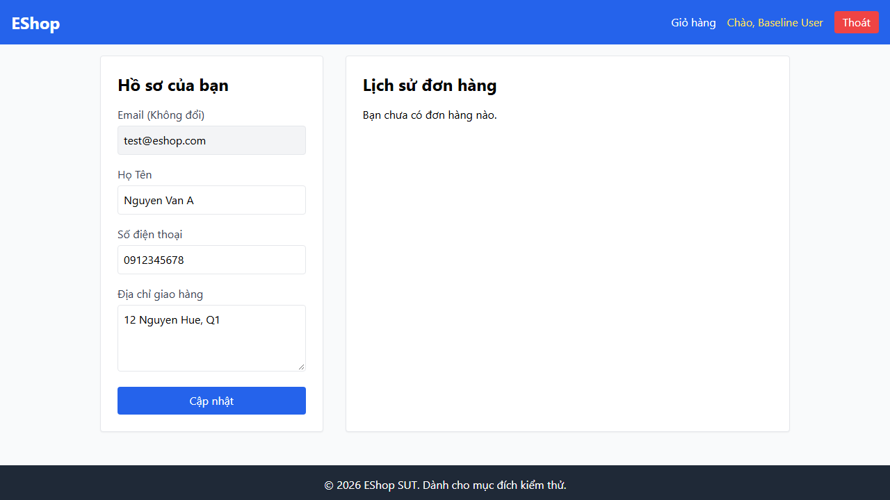

[FR-04][BUG-01] Profile form rejects valid phone numbers (starts with 0, 10-11 digits)

**Feature:** FR-04  |  **Severity:** High  |  **Bug ID:** BUG-01
**Found by automated tests:** TC-04-01, 02, 09, 11, 12, 13 (identical on Chromium, Firefox, WebKit)

## Steps to reproduce
1. Log in as `test@eshop.com` / `Test1234!`
2. Open `/profile`, enter phone `0912345678`
3. Click "Cập nhật"

## Expected (SRS)
FR-04: a phone starting with `0` and having 10-11 digits is valid and is saved ("Cập nhật thành công!").

## Actual
Alert: "Số điện thoại không hợp lệ. Vui lòng nhập đúng 9-10 chữ số." Nothing is saved. No spec-valid phone can be saved.

## Probable cause
`frontend-web/src/pages/Profile.jsx:43` uses `/^[1-9][0-9]{8,9}$/` (first digit 1-9, 9-10 digits) - the opposite of the spec.

## Evidence

Test source: [hw04-automation/tests](https://github.com/UngDuong125/eshop-sut/blob/main/hw04-automation/tests) - HTML reports: [hw04-automation/reports](https://github.com/UngDuong125/eshop-sut/blob/main/hw04-automation/reports)
