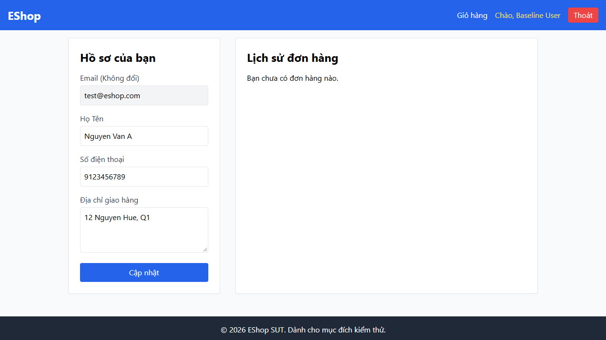

[FR-04][BUG-02] Profile form accepts phone numbers that do not start with 0

**Feature:** FR-04  |  **Severity:** Medium  |  **Bug ID:** BUG-02
**Found by automated tests:** TC-04-05, 06 (identical on Chromium, Firefox, WebKit)

## Steps to reproduce
1. Log in as `test@eshop.com`
2. Open `/profile`, enter phone `9123456789` (or `912345678`)
3. Click "Cập nhật"

## Expected (SRS)
Rejected with a validation message: phone must start with 0.

## Actual
Alert "Cập nhật thành công!" and the number is stored.

## Probable cause
Same regex as BUG-01 (`Profile.jsx:43`) - accepts 9-10 digits starting with 1-9.

## Evidence

Test source: [hw04-automation/tests](https://github.com/UngDuong125/eshop-sut/blob/main/hw04-automation/tests) - HTML reports: [hw04-automation/reports](https://github.com/UngDuong125/eshop-sut/blob/main/hw04-automation/reports)
