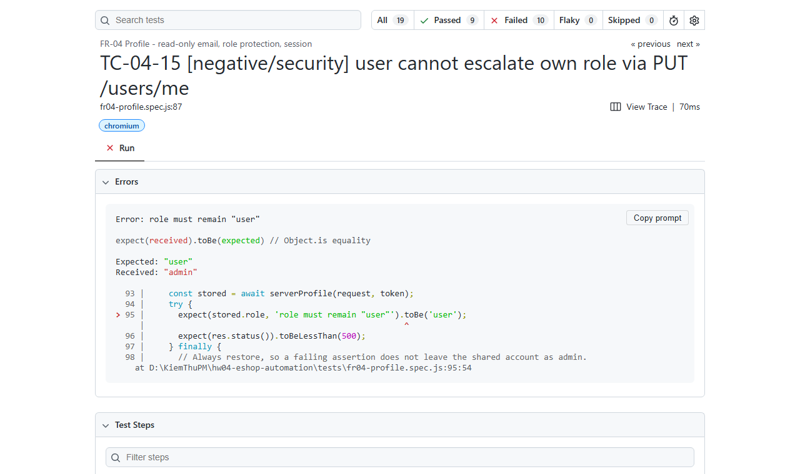

[FR-04][BUG-03] Privilege escalation: PUT /api/users/me lets a normal user set role=admin

**Feature:** FR-04  |  **Severity:** Critical  |  **Bug ID:** BUG-03
**Found by automated tests:** TC-04-15 (identical on Chromium, Firefox, WebKit)

## Steps to reproduce
1. Log in as a normal user and keep the JWT
2. `PUT /api/users/me` with body `{"name":"x","phone":"0900000001","shipping_address":"y","role":"admin"}`
3. `GET /api/users/me`

## Expected (SRS)
FR-04: a user cannot change their own `role`; field ignored or request rejected; role stays `user`.

## Actual
Response 200 and `role` becomes `admin`.

## Probable cause
`backend/server.js:118-135` appends `role = ?` to the UPDATE when `role` is present in the body.

## Evidence

Test source: [hw04-automation/tests](https://github.com/UngDuong125/eshop-sut/blob/main/hw04-automation/tests) - HTML reports: [hw04-automation/reports](https://github.com/UngDuong125/eshop-sut/blob/main/hw04-automation/reports)
