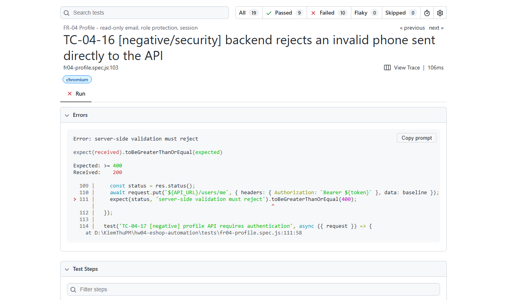

[FR-04][BUG-04] Backend does not validate phone number (invalid value returns 200)

**Feature:** FR-04  |  **Severity:** Medium  |  **Bug ID:** BUG-04
**Found by automated tests:** TC-04-16 (identical on Chromium, Firefox, WebKit)

## Steps to reproduce
1. `PUT /api/users/me` with a valid token and `"phone":"not-a-phone"`

## Expected (SRS)
HTTP 4xx with a validation error (phone must start with 0, 10-11 digits).

## Actual
HTTP 200 "Profile updated". Validation exists only in the browser.

## Probable cause
`backend/server.js:118` performs no validation.

## Evidence

Test source: [hw04-automation/tests](https://github.com/UngDuong125/eshop-sut/blob/main/hw04-automation/tests) - HTML reports: [hw04-automation/reports](https://github.com/UngDuong125/eshop-sut/blob/main/hw04-automation/reports)
