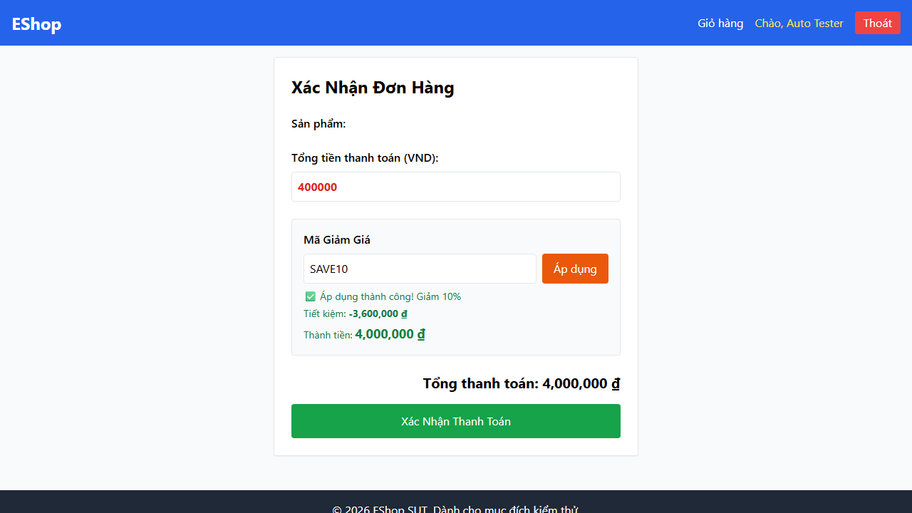

[FR-09][BUG-05] Percent coupon gives a negative discount (total*(1-value) instead of total*value/100)

**Feature:** FR-09  |  **Severity:** Critical  |  **Bug ID:** BUG-05
**Found by automated tests:** TC-09-01, 04, 11 (identical on Chromium, Firefox, WebKit)

## Steps to reproduce
1. Open `/checkout`, set total `400000`
2. Enter coupon `SAVE10` (10%, min 300,000) and click "Áp dụng"

## Expected (SRS)
FR-09: discount = 400000 x 10 / 100 = 40,000; final = 360,000.

## Actual
"Tiết kiệm: -3,600,000 ₫", "Thành tiền: 4,000,000 ₫" - the customer pays more.

## Probable cause
`backend/server.js:399` `Math.floor(total_amount * (1 - coupon.discount_value))`; the DB stores `10`, not `0.1`.

## Evidence

Test source: [hw04-automation/tests](https://github.com/UngDuong125/eshop-sut/blob/main/hw04-automation/tests) - HTML reports: [hw04-automation/reports](https://github.com/UngDuong125/eshop-sut/blob/main/hw04-automation/reports)
