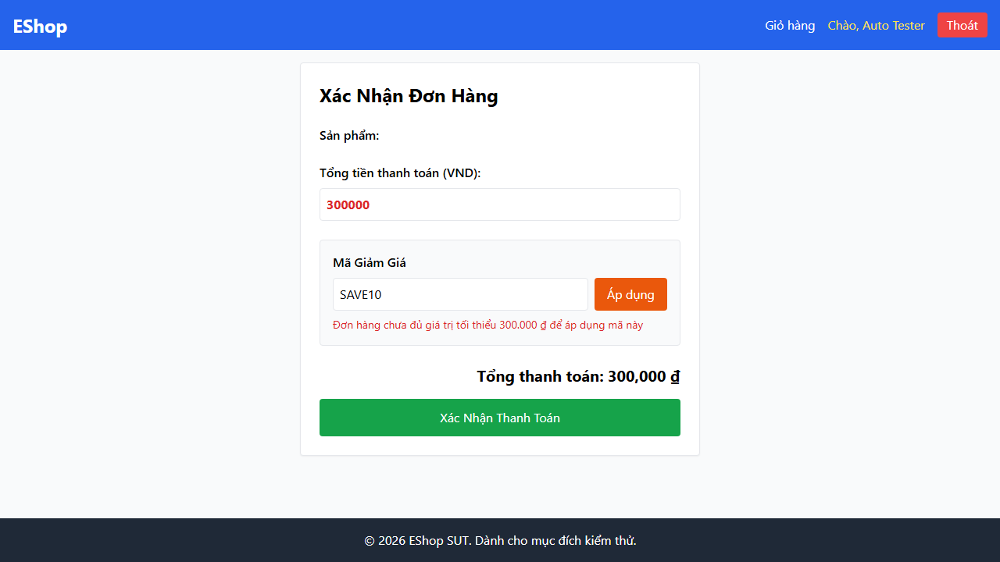

[FR-09][BUG-06] Coupon rejected when order total equals min_order_amount (uses > instead of >=)

**Feature:** FR-09  |  **Severity:** High  |  **Bug ID:** BUG-06
**Found by automated tests:** TC-09-02, 05, 07 (identical on Chromium, Firefox, WebKit)

## Steps to reproduce
1. Open `/checkout`, set total `300000`
2. Apply `SAVE10` (min 300,000)

## Expected (SRS)
FR-09 C3: total >= min_order_amount applies the coupon.

## Actual
"Đơn hàng chưa đủ giá trị tối thiểu 300,000 ₫". Same for BIGBUY at 500,000 and VIP100 at 300,000.

## Probable cause
`backend/server.js:379` `if (total_amount > coupon.min_order_amount)`.

## Evidence

Test source: [hw04-automation/tests](https://github.com/UngDuong125/eshop-sut/blob/main/hw04-automation/tests) - HTML reports: [hw04-automation/reports](https://github.com/UngDuong125/eshop-sut/blob/main/hw04-automation/reports)
