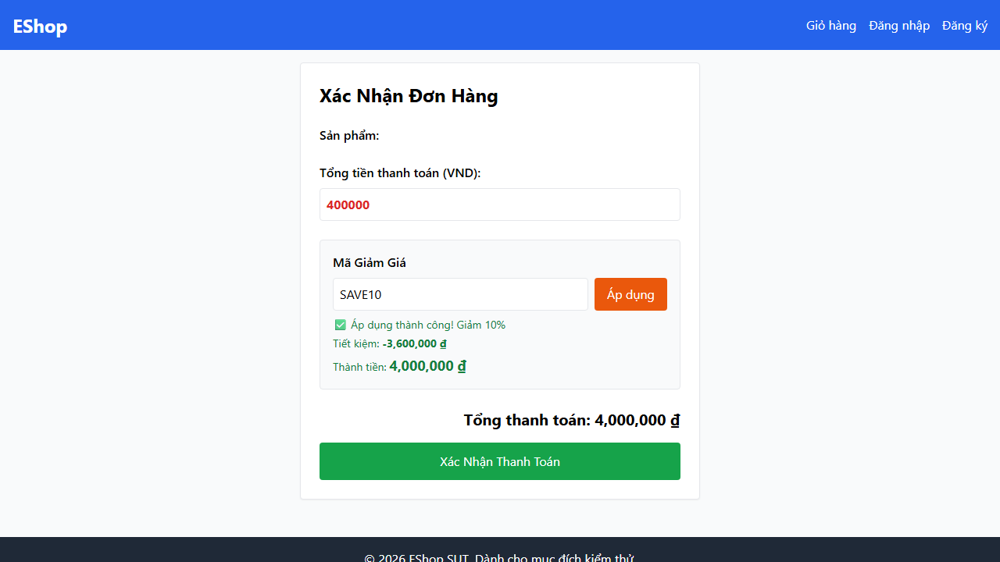

[FR-09][BUG-07] Guest (not logged in) can apply a coupon - condition C4 not enforced

**Feature:** FR-09  |  **Severity:** High  |  **Bug ID:** BUG-07
**Found by automated tests:** TC-09-14 (identical on Chromium, Firefox, WebKit)

## Steps to reproduce
1. Without logging in, open `/checkout`, total `400000`
2. Apply `SAVE10`

## Expected (SRS)
FR-09 C4: a valid JWT is required; guests must be refused.

## Actual
A success message is shown.

## Probable cause
`POST /api/apply-coupon` has no authentication and the `user_id` branch is optional (`server.js:386`).

## Evidence

Test source: [hw04-automation/tests](https://github.com/UngDuong125/eshop-sut/blob/main/hw04-automation/tests) - HTML reports: [hw04-automation/reports](https://github.com/UngDuong125/eshop-sut/blob/main/hw04-automation/reports)
