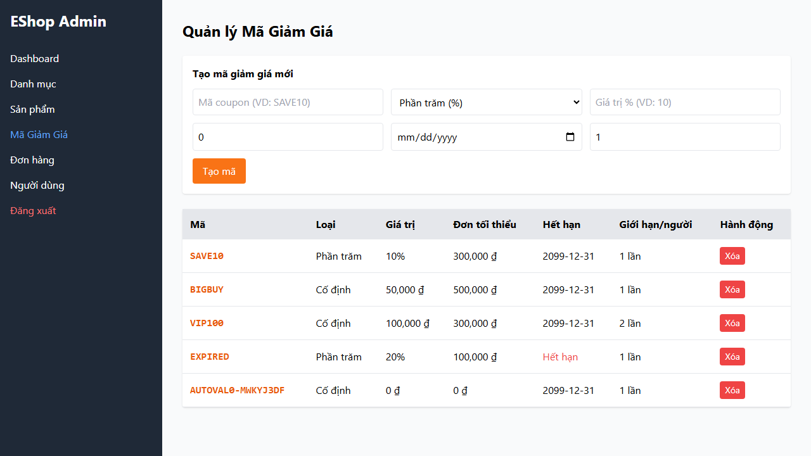
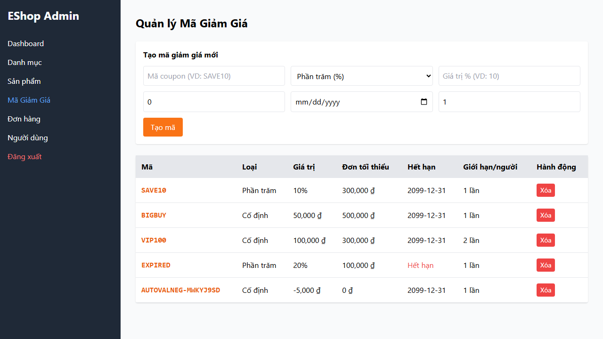

[FR-17][BUG-08] Admin can create a coupon with discount_value 0 or negative

**Feature:** FR-17  |  **Severity:** High  |  **Bug ID:** BUG-08
**Found by automated tests:** TC-17-05, 06 (identical on Chromium, Firefox, WebKit)

## Steps to reproduce
1. Open the admin app (:5174) as admin > "Mã Giảm Giá"
2. Create a coupon with value `0` (then `-5000`)

## Expected (SRS)
FR-17: `discount_value` must be positive - creation rejected.

## Actual
The coupon is stored and listed.

## Probable cause
`backend/server.js:457-481` inserts the body without validation.

## Evidence

Test source: [hw04-automation/tests](https://github.com/UngDuong125/eshop-sut/blob/main/hw04-automation/tests) - HTML reports: [hw04-automation/reports](https://github.com/UngDuong125/eshop-sut/blob/main/hw04-automation/reports)
