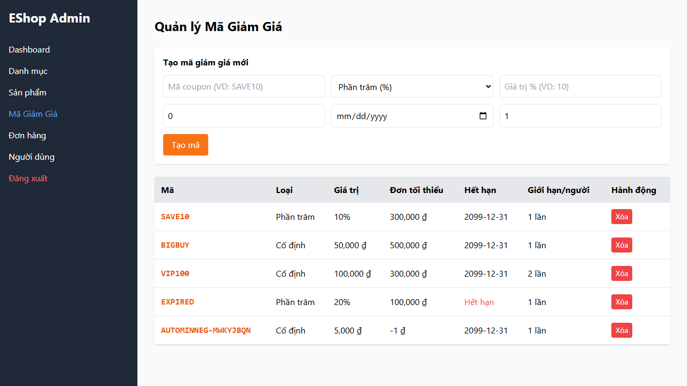

[FR-17][BUG-09] Admin can create a coupon with negative min_order_amount

**Feature:** FR-17  |  **Severity:** Medium  |  **Bug ID:** BUG-09
**Found by automated tests:** TC-17-07 (identical on Chromium, Firefox, WebKit)

## Steps to reproduce
1. Admin app > "Mã Giảm Giá"
2. Create a coupon with "Đơn tối thiểu" = `-1`

## Expected (SRS)
FR-17: `min_order_amount >= 0`.

## Actual
Stored with min_order_amount = -1.

## Probable cause
No server-side validation (`server.js:457`); the input has no `min` attribute.

## Evidence

Test source: [hw04-automation/tests](https://github.com/UngDuong125/eshop-sut/blob/main/hw04-automation/tests) - HTML reports: [hw04-automation/reports](https://github.com/UngDuong125/eshop-sut/blob/main/hw04-automation/reports)
