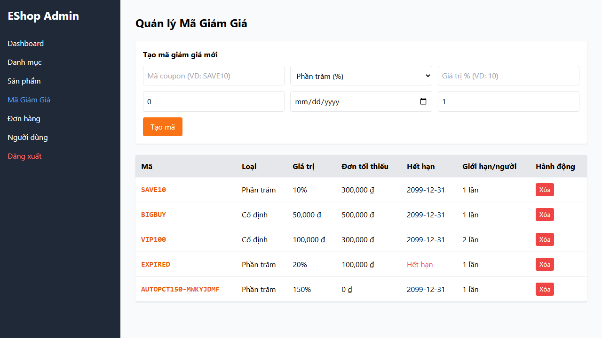

[FR-17][BUG-10] Admin can create a percent coupon above 100%

**Feature:** FR-17  |  **Severity:** Medium  |  **Bug ID:** BUG-10
**Found by automated tests:** TC-17-10 (identical on Chromium, Firefox, WebKit)

## Steps to reproduce
1. Admin app > "Mã Giảm Giá"
2. Type = Phần trăm, value = `150`

## Expected (SRS)
A percent discount over 100% must be rejected (the final amount would be negative). Note: the SRS only says "positive"; this is a reasonable reading.

## Actual
Stored.

## Probable cause
No server-side validation.

## Evidence

Test source: [hw04-automation/tests](https://github.com/UngDuong125/eshop-sut/blob/main/hw04-automation/tests) - HTML reports: [hw04-automation/reports](https://github.com/UngDuong125/eshop-sut/blob/main/hw04-automation/reports)
