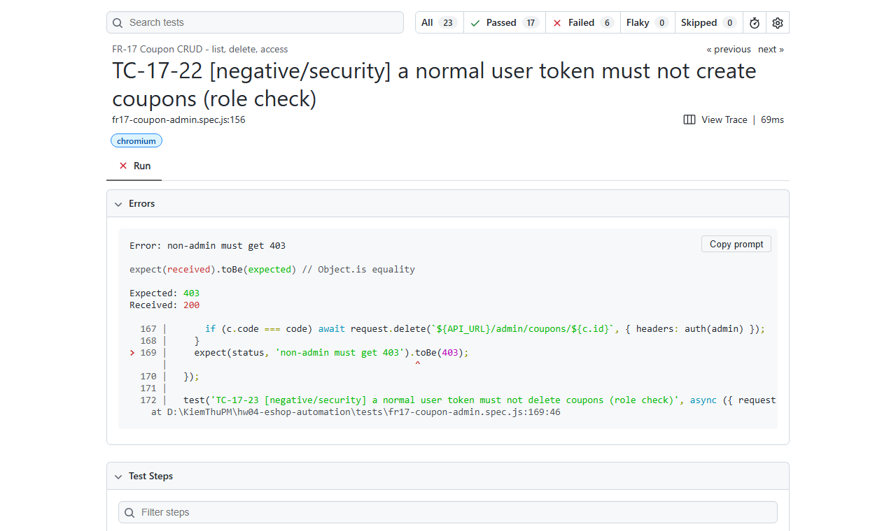

[FR-17][BUG-11] No role check: a normal user token can create and delete coupons

**Feature:** FR-17  |  **Severity:** Critical  |  **Bug ID:** BUG-11
**Found by automated tests:** TC-17-22, 23 (identical on Chromium, Firefox, WebKit)

## Steps to reproduce
1. Log in as `test@eshop.com` (role user) and keep the JWT
2. `POST /api/admin/coupons` with that token and a valid coupon body
3. `DELETE /api/admin/coupons/:id` with the same token

## Expected (SRS)
FR-12/FR-17: admin endpoints return 403 for non-admin users.

## Actual
HTTP 200 for both. (Requests with no token are correctly refused - TC-17-21 passes.)

## Probable cause
`backend/server.js:457,483` only use `authenticateToken`, no admin role check.

## Evidence

Test source: [hw04-automation/tests](https://github.com/UngDuong125/eshop-sut/blob/main/hw04-automation/tests) - HTML reports: [hw04-automation/reports](https://github.com/UngDuong125/eshop-sut/blob/main/hw04-automation/reports)
